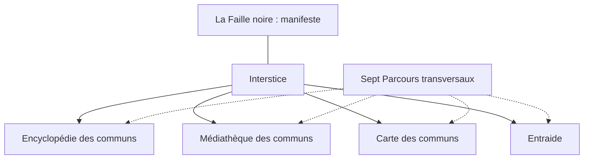

# Organigramme V2 candidat

**Quatre portes ; sept Parcours transversaux.** Les sous-rubriques ci-dessous sont des regroupements de travail, non des rubriques publiques créées. Une ressource n’est pas dupliquée pour apparaître dans plusieurs vues.

Le manifeste est un accès permanent au projet fondateur. Il ne devient pas une porte documentaire. La vue Parcours traverse les ressources sans leur attribuer une origine commune.

## Encyclopédie des communs

Accès historique conservé : `wiki.html`.

| Sous-rubrique de travail | Ressources et identifiants |
|---|---|
| dossiers_a_preciser | `ARCH-001`, `ARCH-003`, `ARCH-008`, `ASSO-001`, `ASSO-002`, `ASSO-003`, `ASSO-004`, `ASSO-005`, `ASSO-006`, `COL-001`, `EXP-001`, `EXP-002`, `EXP-004`, `EXP-005` |
| archives_organisations_et_lieux | `ARCH-002`, `ARCH-004`, `ARCH-005`, `ARCH-006`, `ARCH-007`, `ASSO-007`, `ASSO-008`, `COL-003` |
| personnes_et_reseaux | `BIO-001`, `BIO-002`, `BIO-003`, `BIO-004`, `BIO-005`, `BIO-006`, `BIO-007`, `BIO-008`, `BIO-009`, `BIO-010`, `BIO-011`, `BIO-012`, `BIO-013`, `BIO-014`, `BIO-015`, `BIO-016`, `BIO-017`, `BIO-018`, `BIO-019`, `BIO-020`, `BIO-021`, `BIO-022` |
| histoire_organisations | `wiki-antifascisme-histoire-et-mecanismes.html`, `wiki-antiracisme-histoires-droits.html`, `wiki-frontieres-migrations-colonialisme.html`, `wiki-socialismes-communismes-anarchismes-autogestion.html`, `CAT-001`, `CAT-006`, `ZAP-C10-001` |
| pouvoir_travail_communs | `wiki-association-collegiale.html`, `wiki-capitalisme-classes-travail.html`, `wiki-decision-collective.html`, `wiki-lecture-croisee-travail-soin-pouvoir.html`, `wiki-politique-institutions-regimes.html` |
| ecologies_territoires | `wiki-autonomie-materielle-savoir-faire.html`, `wiki-ecologie-sociale-environnement.html`, `wiki-logement-habitat-droit-ville.html`, `ÉCO-001` |
| cultures_techniques | `wiki-culture-creation-acces-art.html`, `wiki-financements-culture-spectacle.html` |
| egalites_soins | `wiki-education-enfance-protection.html`, `wiki-egalite-fiches.html`, `wiki-egalite-genres-inclusivite.html`, `wiki-feminismes-histoire-egalite.html`, `wiki-handicap-validisme-neurodiversite.html`, `wiki-patriarcat-histoire-mecanismes.html`, `wiki-sante-psychiatrie-autonomie-soins.html` |
| droits_libertes | `wiki-justice-prisons-abolitionnisme.html`, `wiki-liberte-numerique-ia-surveillance.html`, `wiki-police-deces-memoire.html` |
| index | `page:wiki.html`, `page:squats-et-lieux-autonomes.html` |

## Médiathèque des communs

Accès historique conservé : `bibliotheque.html`.

| Sous-rubrique de travail | Ressources et identifiants |
|---|---|
| oeuvres_et_textes | `FN-001`, `FN-002`, `FN-003`, `FN-004`, `FN-005`, `FN-006`, `FN-007`, `FN-008`, `FN-009`, `FN-010`, `FN-011`, `FN-012`, `FN-013`, `FN-014`, `FN-015`, `FN-016`, `FN-017`, `FN-018`, `FN-019`, `FN-020`, `FN-021`, `FN-022`, `FN-023`, `FN-024`, `FN-025`, `FN-026`, `FN-027`, `FN-028`, `FN-029`, `FN-030`, `FN-031`, `FN-032`, `FN-033`, `FN-034`, `FN-035`, `FN-036`, `FN-037`, `FN-038`, `FN-039`, `FN-040`, `FN-041`, `FN-042`, `FN-043`, `FN-044`, `FN-045`, `FN-046`, `FN-047`, `FN-048`, `FN-049`, `FN-050`, `FN-051`, `FN-052`, `FN-053`, `FN-054`, `FN-055`, `FN-056`, `FN-057`, `FN-058`, `FN-059`, `FN-060`, `FN-061`, `FN-062`, `FN-063`, `FN-064`, `FN-065`, `FN-066`, `FN-067`, `FN-068`, `FN-069`, `FN-070`, `FN-071` |
| fonds_ecologie | `ECO-01`, `ECO-02`, `ECO-03`, `ECO-04`, `ECO-05`, `ECO-06`, `ECO-07`, `ECO-08`, `ECO-09`, `ECO-10`, `ECO-11`, `ECO-12`, `ECO-13`, `ECO-14`, `ECO-15`, `ECO-16`, `ECO-17`, `ECO-18`, `ECO-20` |
| portails_et_catalogues | `legacy:ressources:1`, `legacy:ressources:2`, `legacy:ressources:3`, `legacy:ressources:4`, `legacy:ressources:5`, `legacy:ressources:6`, `legacy:ressources:7`, `legacy:ressources:8`, `legacy:ressources:9`, `legacy:ressources:10`, `legacy:ressources:11`, `legacy:ressources:12`, `legacy:ressources:13`, `legacy:ressources:14`, `legacy:ressources:15`, `legacy:ressources:16`, `legacy:ressources:17`, `legacy:ressources:18`, `legacy:ressources:19`, `legacy:ressources:20`, `legacy:ressources:21`, `legacy:ressources:22`, `legacy:ressources:23`, `legacy:ressources:24`, `legacy:ressources:25`, `legacy:ressources:26`, `legacy:ressources:27`, `legacy:ressources:28`, `legacy:ressources:29`, `legacy:ressources:30` |
| index | `page:bibliotheque.html` |

## Carte des communs

Accès historique conservé : `atlas.html`.

| Sous-rubrique de travail | Ressources et identifiants |
|---|---|
| territoires_et_usages | `TIS-001-001`, `TIS-001-002`, `TIS-001-003`, `TIS-001-004`, `TIS-001-005`, `TIS-001-006`, `TIS-001-007`, `TIS-001-008`, `TIS-001-009`, `TIS-001-010`, `TIS-001-011`, `TIS-001-012`, `tis-c8-testet`, `tis-c8-salvetat`, `tis-c8-vrac`, `tis-c8-jardins`, `tis-c8-glanerie`, `tis-c8-3pa`, `tis-c8-tdl`, `tis-c8-sctl` |
| index | `page:atlas.html` |

## Entraide

Accès historique conservé : `parcours.html#entraide`.

| Sous-rubrique de travail | Ressources et identifiants |
|---|---|
| droits_et_orientation | `DROIT-001`, `DROIT-002` |
| index | `page:parcours.html` |

## Règles de relations

Les six types sont `fait_historique_atteste`, `filiation_revendiquee`, `comparaison`, `lien_conceptuel`, `complement_documentaire`, `controverse`. Le niveau de preuve, la nature de la pièce et le statut sont des champs séparés. Une annonce, une décision, une application et un résultat ne s’équivalent pas. Aucune filiation revendiquée n’est instanciée sans source explicite.

La Carte contient 20 objets Tisseuse (19 entités/ressources et une notice territoriale dans son inventaire), sans coordonnées ajoutées et sans coopération Interstice attestée. Les lieux historiques non identifiés ne reçoivent pas de fiche cartographique fictive. Entraide conserve ses dossiers internes bloqués : ni annuaire de permanences actives ni collecte de cas.

## Registre lisible complet

| Identifiant | Titre ou objet | Porte principale | Disponibilité documentaire |
|---|---|---|---|
| ARCH-001 | Lettre de 1907 et Mary Eato Lydia Smith — recherche | encyclopedie | metadonnees_drive_localisees_corps_non_lu |
| ARCH-002 | Affiche n°373 (20 mai 1871) — chambres syndicales des ouvrières | encyclopedie | metadonnees_drive_localisees_corps_non_lu |
| ARCH-003 | Affiche n°331 (15 mai 1871) — inscriptions des ouvrières | encyclopedie | metadonnees_drive_localisees_corps_non_lu |
| ARCH-004 | Appel aux ouvrières n°342, 18 mai 1871 | encyclopedie | metadonnees_drive_localisees_corps_non_lu |
| ARCH-005 | Ateliers d’armes du Louvre — projets de règlement | encyclopedie | matrice_branche_lue |
| ARCH-006 | Le Prolétaire — presse du Club des prolétaires | encyclopedie | matrice_branche_lue |
| ARCH-007 | Décret du 16 avril 1871 sur les ateliers abandonnés | encyclopedie | dossier_drive_lu |
| ARCH-008 | Manifeste du 6 mai 1871 de l’Union des femmes — défense, travail et conflit autour de la paix | encyclopedie | metadonnees_drive_localisees_corps_non_lu |
| ASSO-001 | White Rose Mission and Industrial Association — fiche candidate | encyclopedie | metadonnees_drive_localisees_corps_non_lu |
| ASSO-002 | Woman's Loyal Union — fiche candidate | encyclopedie | metadonnees_drive_localisees_corps_non_lu |
| ASSO-003 | Equal Suffrage League de Brooklyn — candidate | encyclopedie | metadonnees_drive_localisees_corps_non_lu |
| ASSO-004 | Lincoln Settlement House — fiche candidate | encyclopedie | metadonnees_drive_localisees_corps_non_lu |
| ASSO-005 | Niagara Movement — histoire critique | encyclopedie | metadonnees_drive_localisees_corps_non_lu |
| ASSO-006 | Phyllis Wheatley Club de Buffalo — recherche | encyclopedie | metadonnees_drive_localisees_corps_non_lu |
| ASSO-007 | Union des femmes pour la défense de Paris et les soins aux blessés | encyclopedie | dossier_drive_lu |
| ASSO-008 | La Marmite — société civile d’alimentation (1868) | encyclopedie | dossier_drive_lu |
| BIO-001 | Ida B. Wells | encyclopedie | rapport_biographe_lu |
| BIO-002 | Victoria Earle Matthews | encyclopedie | rapport_biographe_lu |
| BIO-003 | Maritcha Remond Lyons | encyclopedie | rapport_biographe_lu |
| BIO-004 | Sarah Smith Garnet | encyclopedie | rapport_biographe_lu |
| BIO-005 | Susan Smith McKinney Steward | encyclopedie | rapport_biographe_lu |
| BIO-006 | Verina Morton-Jones | encyclopedie | rapport_biographe_lu |
| BIO-007 | Mary Burnett Talbert | encyclopedie | rapport_biographe_lu |
| BIO-008 | Louise Michel | encyclopedie | rapport_biographe_lu |
| BIO-009 | Nathalie Le Mel | encyclopedie | rapport_biographe_lu |
| BIO-010 | Élisabeth Dmitrieff | encyclopedie | rapport_biographe_lu |
| BIO-011 | André Léo | encyclopedie | rapport_biographe_lu |
| BIO-012 | Eugène Varlin | encyclopedie | rapport_biographe_lu |
| BIO-013 | Paule Minck | encyclopedie | rapport_biographe_lu |
| BIO-014 | Léo Frankel | encyclopedie | rapport_biographe_lu |
| BIO-015 | Augustin Avrial | encyclopedie | rapport_biographe_lu |
| BIO-016 | Anna Julia Cooper | encyclopedie | rapport_biographe_lu |
| BIO-017 | Louise Talbot | encyclopedie | rapport_biographe_lu |
| BIO-018 | Aline Jacquier | encyclopedie | rapport_biographe_lu |
| BIO-019 | Blanche Lefebvre | encyclopedie | rapport_biographe_lu |
| BIO-020 | Élisabeth Deguy | encyclopedie | rapport_biographe_lu |
| BIO-021 | Joséphine Dulimbert / Dulembert | encyclopedie | rapport_biographe_lu |
| BIO-022 | Anne-Marie Ménand | encyclopedie | rapport_biographe_lu |
| COL-001 | Femmes de New York et Brooklyn et Southern Horrors (1892) | encyclopedie | metadonnees_drive_localisees_corps_non_lu |
| COL-003 | Club des prolétaires — Saint-Ambroise | encyclopedie | matrice_branche_lue |
| EXP-001 | Freegan Pony — cantine participative et récupération alimentaire | encyclopedie | metadonnees_drive_localisees_corps_non_lu |
| EXP-002 | Caisse alimentaire commune de Montpellier — recherche critique | encyclopedie | metadonnees_drive_localisees_corps_non_lu |
| EXP-004 | Mondragón — fédération coopérative et démocratie économique | encyclopedie | metadonnees_drive_localisees_corps_non_lu |
| EXP-005 | Barcelona en Comú et Decidim — démocratie et limites numériques | encyclopedie | metadonnees_drive_localisees_corps_non_lu |
| FN-001 | Discours de la servitude volontaire | mediatheque | notice_catalogue_lue |
| FN-002 | La Conquête du pain | mediatheque | notice_catalogue_lue |
| FN-003 | Qu’est-ce que la propriété ? | mediatheque | notice_catalogue_lue |
| FN-004 | L'Entraide, un facteur de l'évolution | mediatheque | notice_catalogue_lue |
| FN-005 | Sita Sings the Blues | mediatheque | notice_catalogue_lue |
| FN-006 | Bound by Law? Tales from the Public Domain | mediatheque | notice_catalogue_lue |
| FN-007 | Déclaration des droits de la femme et de la citoyenne | mediatheque | notice_catalogue_lue |
| FN-008 | The Souls of Black Folk | mediatheque | notice_catalogue_lue |
| FN-009 | The Tyranny of Structurelessness | mediatheque | notice_catalogue_lue |
| FN-010 | Indígenas e quilombolas brasileiros contam sua história — Povo Gavião, partie 13 | mediatheque | notice_catalogue_lue |
| FN-011 | Indígenas e quilombolas brasileiros contam sua história — Quilombo Praia Grande, partie 01 | mediatheque | notice_catalogue_lue |
| FN-012 | After Capitalism: a Cooperative Economy | mediatheque | notice_catalogue_lue |
| FN-013 | This Land Is Our Land: The Fight to Reclaim the Commons | mediatheque | notice_catalogue_lue |
| FN-014 | (Sobre)Vivências | mediatheque | notice_catalogue_lue |
| FN-015 | Queer the Campus: A Documentary | mediatheque | notice_catalogue_lue |
| FN-016 | Gay and Proud | mediatheque | notice_catalogue_lue |
| FN-017 | Pepper&Carrot, épisode 26 « Les livres, c’est génial » | mediatheque | notice_catalogue_lue |
| FN-018 | Pepper et Superflu | mediatheque | notice_catalogue_lue |
| FN-019 | Consensus Decision Making | mediatheque | notice_catalogue_lue |
| FN-020 | Online Decision Making | mediatheque | notice_catalogue_lue |
| FN-021 | Dieu et l'État | mediatheque | notice_catalogue_lue |
| FN-022 | La Commune | mediatheque | notice_catalogue_lue |
| FN-023 | Mémoires de Louise Michel, écrits par elle-même | mediatheque | notice_catalogue_lue |
| FN-024 | The Seedkeepers | mediatheque | notice_catalogue_lue |
| FN-025 | Women at work — Chatpatit | mediatheque | notice_catalogue_lue |
| FN-026 | The Cargo Women of Melilla | mediatheque | notice_catalogue_lue |
| FN-027 | Esther Duflo: Representation for Women in India | mediatheque | notice_catalogue_lue |
| FN-028 | Comixplain, « Attribute Types » | mediatheque | notice_catalogue_lue |
| FN-029 | My Disillusionment in Russia | mediatheque | notice_catalogue_lue |
| FN-030 | Direct Action | mediatheque | notice_catalogue_lue |
| FN-031 | Southern Horrors: Lynch Law in All Its Phases | mediatheque | notice_catalogue_lue |
| FN-032 | Ise ileke sinsin (Beads making) | mediatheque | notice_catalogue_lue |
| FN-033 | Woman and Labour | mediatheque | notice_catalogue_lue |
| FN-034 | The Land of Little Rain | mediatheque | notice_catalogue_lue |
| FN-035 | Women and Economics: A Study of the Economic Relation Between Men and Women as a Factor in Social Evolution | mediatheque | notice_catalogue_lue |
| FN-036 | The Principles of Anarchism (Les principes de l'anarchisme) | mediatheque | notice_catalogue_lue |
| FN-037 | The CARE Principles for Indigenous Data Governance | mediatheque | notice_catalogue_lue |
| FN-038 | Principes féministes de l’internet, version 2.0 / Feminist Principles of the Internet 2.0 | mediatheque | notice_catalogue_lue |
| FN-039 | Share alike : Ensemble, tout devient possible | mediatheque | notice_catalogue_lue |
| FN-040 | Elephants Dream | mediatheque | notice_catalogue_lue |
| FN-041 | American Indian Stories | mediatheque | notice_catalogue_lue |
| FN-042 | Life Among the Piutes: Their Wrongs and Claims | mediatheque | notice_catalogue_lue |
| FN-043 | Better Practices in the Classroom: A Teaching Guidebook for Sustainable, Inclusive, and Equitable Learning from a Gender and Sexuality Studies Framework. Autrices : Natalie Kouri-Towe et Myloe Martel-Perry. Édition : 2 mai 2024, Concordia University Library, version révisée d'un guide de 2021. Type : guide pédagogique / livre numérique. Langue : anglais. Piliers officiels : 1 « Éducation populaire et émancipation » | mediatheque | notice_catalogue_lue |
| FN-044 | Dulce | mediatheque | notice_catalogue_lue |
| FN-045 | Déclaration au peuple français | mediatheque | notice_catalogue_lue |
| FN-046 | Appels et statuts de l’Union des femmes pour la défense de Paris et les soins aux blessés | mediatheque | notice_catalogue_lue |
| FN-047 | L’Urgence de ralentir | mediatheque | notice_catalogue_lue |
| FN-048 | La Commune (Louise Michel, 1898) | mediatheque | notice_catalogue_lue |
| FN-049 | A Room of One's Own (Une chambre à soi) | mediatheque | notice_catalogue_lue |
| FN-050 | The Theory of the Leisure Class: An Economic Study in the Evolution of Institutions | mediatheque | notice_catalogue_lue |
| FN-051 | Jamais sans ma visseuse | mediatheque | notice_catalogue_lue |
| FN-052 | Sintel | mediatheque | notice_catalogue_lue |
| FN-053 | Comic strips Linux TCP BBR | mediatheque | notice_catalogue_lue |
| FN-054 | Pulling Together: A Guide for Curriculum Developers | mediatheque | notice_catalogue_lue |
| FN-055 | Introduction to Women, Gender, Sexuality Studies | mediatheque | notice_catalogue_lue |
| FN-056 | Limitações no processo de desenvolvimento e manutenção de cooperativas rurais do Vale do Arinos, Mato Grosso | mediatheque | notice_catalogue_lue |
| FN-057 | Principes féministes de l’internet 2.0 / Feminist Principles of the Internet, Version 2.0 | mediatheque | notice_catalogue_lue |
| FN-058 | 10 Principles of Disability Justice / Dix principes de justice du handicap | mediatheque | notice_catalogue_lue |
| FN-059 | Together: The Documentary on Coop Resilience | mediatheque | notice_catalogue_lue |
| FN-060 | Freedom or Fairness? (Mimi & Eunice, strip n°456) | mediatheque | notice_catalogue_lue |
| FN-061 | Traditional Knowledge/Biocultural Labels: Usage and Style Guide | mediatheque | notice_catalogue_lue |
| FN-062 | Little Bear's Day / ᒪᐢᑯᓯᐢ ᐅᑮᓯᑳᒼ / Un jour avec Petit Ours | mediatheque | notice_catalogue_lue |
| FN-063 | Data Feminism | mediatheque | notice_catalogue_lue |
| FN-064 | Design Justice Network Principles | mediatheque | notice_catalogue_lue |
| FN-065 | Recommandation sur une science ouverte | mediatheque | notice_catalogue_lue |
| FN-066 | State of the Commons 2022 | mediatheque | notice_catalogue_lue |
| FN-067 | Tejid@s Junt@s / Stitched Together: Workers, Students, and the Movement for Alta Gracia | mediatheque | notice_catalogue_lue |
| FN-068 | Nous sommes partout : sauvegarde n°1 / Suisse romande | mediatheque | notice_catalogue_lue |
| FN-069 | The Combahee River Collective Statement | mediatheque | notice_catalogue_lue |
| FN-070 | A Voice from the South: By a Black Woman of the South | mediatheque | notice_catalogue_lue |
| FN-071 | Superheroes on the Move: A Comic on Sustainable Mobility | mediatheque | notice_catalogue_lue |
| wiki-antifascisme-histoire-et-mecanismes.html | Antifascisme, histoire et défense des libertés. | encyclopedie | fichier_main_lu |
| wiki-antiracisme-histoires-droits.html | Comprendre le racisme.Documenter l'égalité. | encyclopedie | fichier_main_lu |
| wiki-association-collegiale.html | Créer une association collégiale | encyclopedie | fichier_main_lu |
| wiki-autonomie-materielle-savoir-faire.html | Autonomie matérielle et savoir-faire. | encyclopedie | fichier_main_lu |
| wiki-capitalisme-classes-travail.html | Capitalisme, classes sociales et monde du travail. | encyclopedie | fichier_main_lu |
| wiki-culture-creation-acces-art.html | Culture, création et accès à l’art. | encyclopedie | fichier_main_lu |
| wiki-decision-collective.html | Décider ensemble. | encyclopedie | fichier_main_lu |
| wiki-ecologie-sociale-environnement.html | Écologie sociale et crise environnementale. | encyclopedie | fichier_main_lu |
| wiki-education-enfance-protection.html | Éducation, enfance et protection. | encyclopedie | fichier_main_lu |
| wiki-egalite-fiches.html | Égalité, genres et inclusivité. | encyclopedie | fichier_main_lu |
| wiki-egalite-genres-inclusivite.html | Égalité, genres et inclusivité. | encyclopedie | fichier_main_lu |
| wiki-feminismes-histoire-egalite.html | Féminismes : comprendre, transmettre, documenter. | encyclopedie | fichier_main_lu |
| wiki-financements-culture-spectacle.html | Financer la création, la diffusion et les tournées. | encyclopedie | fichier_main_lu |
| wiki-frontieres-migrations-colonialisme.html | Frontières, migrations et colonialisme. | encyclopedie | fichier_main_lu |
| wiki-handicap-validisme-neurodiversite.html | Handicap, validisme et neurodiversité. | encyclopedie | fichier_main_lu |
| wiki-justice-prisons-abolitionnisme.html | Justice, prisons et abolitionnisme pénal. | encyclopedie | fichier_main_lu |
| wiki-lecture-croisee-travail-soin-pouvoir.html | Qui fait vivre les communs ? | encyclopedie | fichier_main_lu |
| wiki-liberte-numerique-ia-surveillance.html | Libertés numériques, surveillance et intelligence artificielle. | encyclopedie | fichier_main_lu |
| wiki-logement-habitat-droit-ville.html | Logement, habitat et droit à la ville | encyclopedie | fichier_main_lu |
| wiki-patriarcat-histoire-mecanismes.html | Le patriarcat : histoire, pouvoirs et mécanismes. | encyclopedie | fichier_main_lu |
| wiki-police-deces-memoire.html | Police, décès et mémoire. | encyclopedie | fichier_main_lu |
| wiki-politique-institutions-regimes.html | Qui gouverne ? Comment le pouvoir s'organise. | encyclopedie | fichier_main_lu |
| wiki-sante-psychiatrie-autonomie-soins.html | Santé, psychiatrie et autonomie des soins. | encyclopedie | fichier_main_lu |
| wiki-socialismes-communismes-anarchismes-autogestion.html | Socialismes, communismes, anarchismes et autogestion. | encyclopedie | fichier_main_lu |
| ÉCO-001 | Histoire des écologies, écologie sociale, végétarismes et véganismes | encyclopedie | dossier_main_lu |
| ECO-01 | Silent Spring | mediatheque | notice_catalogue_lue |
| ECO-02 | How a tree-hugging protest transformed Indian environmentalism | mediatheque | notice_catalogue_lue |
| ECO-03 | Our History — Green Belt Movement | mediatheque | notice_catalogue_lue |
| ECO-04 | 1971-1981 — Le Larzac militant | mediatheque | notice_catalogue_lue |
| ECO-05 | Contestation du projet de construction d'une centrale nucléaire à Plogoff | mediatheque | notice_catalogue_lue |
| ECO-06 | Environmental Justice Primer for Ports — Timeline of American Environmental Justice Movement | mediatheque | notice_catalogue_lue |
| ECO-07 | L’Homme et la Nature — De l’action humaine sur la géographie physique | mediatheque | notice_catalogue_lue |
| ECO-08 | Ecology and Revolutionary Thought | mediatheque | notice_catalogue_lue |
| ECO-09 | Le Féminisme ou la Mort | mediatheque | notice_catalogue_lue |
| ECO-10 | Governing the Commons: The Evolution of Institutions for Collective Action | mediatheque | notice_catalogue_lue |
| ECO-11 | À propos du végétarisme | mediatheque | notice_catalogue_lue |
| ECO-12 | Jainism and Food | mediatheque | notice_catalogue_lue |
| ECO-13 | History — Vegetarian Society | mediatheque | notice_catalogue_lue |
| ECO-14 | History — The Vegan Society | mediatheque | notice_catalogue_lue |
| ECO-15 | Animals’ Rights: Considered in Relation to Social Progress | mediatheque | notice_catalogue_lue |
| ECO-16 | Climate Change 2022: Mitigation of Climate Change — AR6 WGIII, chapitre 12 Cross sectoral perspectives | mediatheque | notice_catalogue_lue |
| ECO-17 | Vegans, vegetarians, fish-eaters and meat-eaters in the UK show discrepant environmental impacts | mediatheque | notice_catalogue_lue |
| ECO-18 | Reducing climate change impacts from the global food system through diet shifts | mediatheque | notice_catalogue_lue |
| ECO-20 | Convention (n° 184) sur la sécurité et la santé dans l'agriculture | mediatheque | notice_catalogue_lue |
| TIS-001-001 | La Maison du Vélo | carte | inventaire_tisseuse_lu |
| TIS-001-002 | Afev Albi | carte | inventaire_tisseuse_lu |
| TIS-001-003 | MJC Rabastens-Couffouleux | carte | inventaire_tisseuse_lu |
| TIS-001-004 | MJC de Gaillac | carte | inventaire_tisseuse_lu |
| TIS-001-005 | Le Pigeonnier | carte | inventaire_tisseuse_lu |
| TIS-001-006 | L’R de Rien | carte | inventaire_tisseuse_lu |
| TIS-001-007 | P’tite Lumière et Cie | carte | inventaire_tisseuse_lu |
| TIS-001-008 | Lenga Viva | carte | inventaire_tisseuse_lu |
| TIS-001-009 | Hors-Loge | carte | inventaire_tisseuse_lu |
| TIS-001-010 | L’Atelier de Najac | carte | inventaire_tisseuse_lu |
| TIS-001-011 | Sous les Toiles | carte | inventaire_tisseuse_lu |
| TIS-001-012 | Les Hauts Parleurs | carte | inventaire_tisseuse_lu |
| tis-c8-testet | Testet / bassin du Tescou | carte | inventaire_tisseuse_lu |
| tis-c8-salvetat | La Salvetat / Les Chlorophy’liens | carte | inventaire_tisseuse_lu |
| tis-c8-vrac | VRAC Toulouse | carte | inventaire_tisseuse_lu |
| tis-c8-jardins | Partageons les Jardins | carte | inventaire_tisseuse_lu |
| tis-c8-glanerie | La Glanerie | carte | inventaire_tisseuse_lu |
| tis-c8-3pa | 3PA / Bordanova | carte | inventaire_tisseuse_lu |
| tis-c8-tdl | Terre de Liens Midi-Pyrénées | carte | inventaire_tisseuse_lu |
| tis-c8-sctl | Société civile des terres du Larzac (SCTL) | carte | inventaire_tisseuse_lu |
| CAT-001 | Collectivisations révolutionnaires en Catalogne | encyclopedie | dossier_signale_texte_non_obtenu |
| CAT-006 | Journées de mai 1937 | encyclopedie | dossier_signale_texte_non_obtenu |
| ZAP-C10-001 | Zapatisme — chronologie, traductions et comparaison documentaire | encyclopedie | dossier_branche_lu |
| DROIT-001 | Manifestations, contrôles, garde à vue — dossier documentaire | entraide | bibliographie_main_lue |
| DROIT-002 | Logement, expulsions et aides — dossier documentaire | entraide | bibliographie_main_lue |
| legacy:ressources:1 | Leurs Votes | mediatheque | donnee_main_lue |
| legacy:ressources:2 | Bon Pote | mediatheque | donnee_main_lue |
| legacy:ressources:3 | Ritimo | mediatheque | donnee_main_lue |
| legacy:ressources:4 | data.gouv.fr | mediatheque | donnee_main_lue |
| legacy:ressources:5 | Low-tech Lab | mediatheque | donnee_main_lue |
| legacy:ressources:6 | L'Atelier Paysan | mediatheque | donnee_main_lue |
| legacy:ressources:7 | Open Source Ecology | mediatheque | donnee_main_lue |
| legacy:ressources:8 | Wikilivres | mediatheque | donnee_main_lue |
| legacy:ressources:9 | Movilab | mediatheque | donnee_main_lue |
| legacy:ressources:10 | Réseau des communs | mediatheque | donnee_main_lue |
| legacy:ressources:11 | Framasoft | mediatheque | donnee_main_lue |
| legacy:ressources:12 | CHATONS | mediatheque | donnee_main_lue |
| legacy:ressources:13 | OpenStreetMap | mediatheque | donnee_main_lue |
| legacy:ressources:14 | Transiscope | mediatheque | donnee_main_lue |
| legacy:ressources:15 | FabLabs.io | mediatheque | donnee_main_lue |
| legacy:ressources:16 | Framalibre | mediatheque | donnee_main_lue |
| legacy:ressources:17 | Wikisource | mediatheque | donnee_main_lue |
| legacy:ressources:18 | Internet Archive | mediatheque | donnee_main_lue |
| legacy:ressources:19 | Repair Café | mediatheque | donnee_main_lue |
| legacy:ressources:20 | Open Food Facts | mediatheque | donnee_main_lue |
| legacy:ressources:21 | CIRA Marseille | mediatheque | donnee_main_lue |
| legacy:ressources:22 | Bibliothèque anarchiste | mediatheque | donnee_main_lue |
| legacy:ressources:23 | Anarchist Libraries (français) | mediatheque | donnee_main_lue |
| legacy:ressources:24 | Éditions du Monde Libertaire | mediatheque | donnee_main_lue |
| legacy:ressources:25 | Éditions Libertaires | mediatheque | donnee_main_lue |
| legacy:ressources:26 | Service-Public : créer une association | mediatheque | donnee_main_lue |
| legacy:ressources:27 | Associations.gouv.fr | mediatheque | donnee_main_lue |
| legacy:ressources:28 | La Contemporaine | mediatheque | donnee_main_lue |
| legacy:ressources:29 | CoopCycle | mediatheque | donnee_main_lue |
| legacy:ressources:30 | Emmaüs Connect | mediatheque | donnee_main_lue |
| page:wiki.html | Encyclopédie des communs | encyclopedie | fichier_main_lu |
| page:bibliotheque.html | Médiathèque des communs | mediatheque | fichier_main_lu |
| page:atlas.html | Carte des communs | carte | fichier_main_lu |
| page:parcours.html | Ancien index Parcours et ancre Entraide | entraide | fichier_main_lu |
| page:squats-et-lieux-autonomes.html | Squats et lieux autonomes | encyclopedie | fichier_main_lu |
