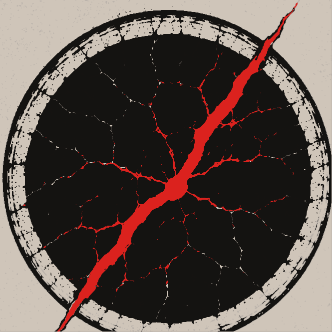
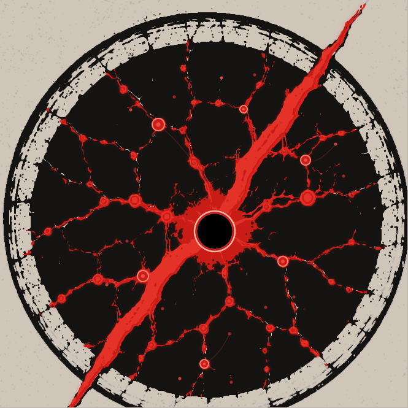

# R7 · La Faille noire / Interstice — planche de comparaison

**Statut : variantes graphiques candidates, non validées, non intégrées, non publiées.** Les visuels ci-dessous sont les fichiers SVG issus des vrais éléments du dépôt, pas des illustrations de substitution.

## La Faille noire · matrice inchangée

Le noyau graphique original est conservé intact. La Faille noire ne reçoit **aucun des six points secondaires**.

## Trois variantes Interstice

| A · Nœuds discrets | B · Ramifications | C · Archipel |
|:---:|:---:|:---:|
|  |  |  |
| Le centre reste dominant. Les six accès sont visibles sans lignes de navigation envahissantes. | Les six ramifications dialoguent davantage avec le logo-source ; les petits points évoquent les sous-menus. | Les six pôles forment des grappes inégales avec halos discrets, pour un effet moins cartésien. |

## Principes communs

- Centre d'origine **(350,377)**, diamètre principal inchangé.
- Six points secondaires à des coordonnées **déjà présentes dans la source R6** : (258,203), (397,178), (498,261), (461,426), (333,593), (233,450).
- Petits points tertiaires expérimentaux construits autour de chaque pôle, sans étiquette ni URL publique.
- Pas de distribution mathématique à 60° ; pas de réinterprétation du logo de La Faille noire.
- La correspondance des six positions aux six portes reste à arbitrer par Zout avant toute navigation interactive.

## Contrôles et réserves

Le SVG Interstice R6 utilisé comme substrat est **une harmonisation candidate**, pas un original approuvé de façon définitive. La Faille noire originale et les références vectorielles de Zout sont archivées dans `assets/identite/r6/sources/` sans modification.

**Aucune intégration à** `assets/logo-interstice.svg`, aucune modification de `main`, aucun déploiement. Relecture à faire : Graphiste, expérience de navigation, rendu petit format et accessibilité.

Voir le rapport détaillé : [RELIEUSE_R7_SIX_POINTS_INTERSTICE_CANDIDATS.md](../coordination/work/r7/RELIEUSE_R7_SIX_POINTS_INTERSTICE_CANDIDATS.md).
